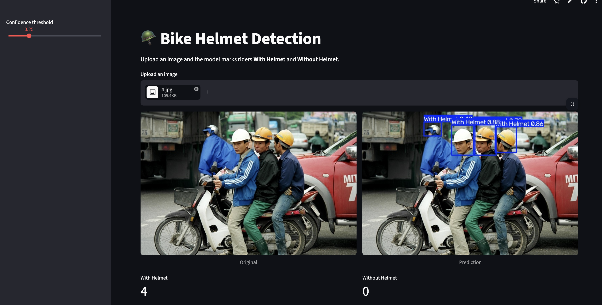

# 🪖 Bike Helmet Detection

Detects whether motorbike riders are **wearing a helmet or not** in images, using a fine-tuned **YOLO26m** model and a simple web app.

## 🔴 Live Demo

**👉 [Try the app](https://helmet-detection-bike.streamlit.app/)**

Upload an image and the app draws boxes labeled **With Helmet** or **Without Helmet**.


*Model output on a test image: boxes show the detected class and confidence score.*


## Dataset

[Bike Helmet Detection](https://universe.roboflow.com/bike-helmets/bike-helmet-detection-2vdjo) on Roboflow Universe (v2): 3,546 train / 126 validation / 63 test images, 2 classes.

## Method

1. Loaded the dataset from Roboflow into Google Colab
2. Fine-tuned a COCO-pretrained **YOLO26m** (Ultralytics) on the raw images: 100 epochs, 640×640, batch 16, early-stopping patience 20, on an A100 GPU
3. Evaluated on the held-out test set
4. Exported the best model (`.pt` and `.onnx`) and built the web app

## Results (test set)

| Class | Precision | Recall | mAP@50 | mAP@50-95 |
|---|---|---|---|---|
| **All** | 0.911 | 0.867 | 0.911 | 0.486 |
| With Helmet | 0.945 | 0.832 | 0.917 | 0.500 |
| Without Helmet | 0.876 | 0.902 | 0.906 | 0.472 |

Inference: about 3.8 ms per image on an A100.

## Run Locally

```bash
git clone https://github.com/YOUR-USERNAME/bike-helmet-detection.git
cd bike-helmet-detection
pip install -r requirements.txt
streamlit run app.py
```

## Project Structure

```
├── app.py              # Web app
├── best.pt             # Trained weights
├── requirements.txt
```

## Tech Stack

Python · Ultralytics YOLO26 · PyTorch · OpenCV · Streamlit · Roboflow · 

## Limitations

- The test set is small (63 images), so scores can move by a few points between runs
- Accuracy may drop on small, blurry or heavily occluded riders

## Author

**Nure Alam Siddiki Rachin** · CSE, Daffodil International University
[LinkedIn](https://www.linkedin.com/in/YOUR-PROFILE) · [GitHub](https://github.com/YOUR-USERNAME)
